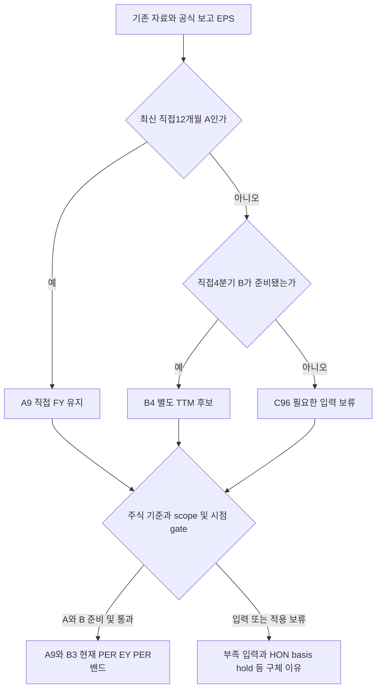

# 공식 분기 EPS 연결 후 기업별 조회 결과 — 2026-11-16

[실행 계약](reported-quarter-eps-ttm-20261116.md)의 동결 소스 `4e4216555b`와 새 불변 발행물의
**실제 API 및 ROOT 로컬/운영 인수** 조회값이다. source/실자료/실제 consumer와 별도 local
runtime의 Sol 독립 검증은 PASS이며 운영18765/PID38488에서 같은 값을 확인했다. PR107은
draft, 제품4e 전체 CI는3,279PASS/47SKIP·Ruff PASS로 성공했고 최종 docs head CI/main은 별도 대기다.

운영 [가격 지표 화면](http://127.0.0.1:18765/)에서 기업을 선택해 조회한다.

현재 평가일은 **11/16**, 종가 세션과 재무 공개 cutoff는 **11/13**이다. 새 TTM 세 입력의
actual ready는11/16이며 과거11/13의 준비 입력으로 간주하지 않는다. 현재 TTM 결과는
`historical_ready=false`, `backtest_eligible=false`다. 고정 자료이며 자동 갱신하지 않는다.

109×26 실제 latest 관측2,834개 중 **1,335가용/1,499미준비**다. PER와 이익수익률은 각각
12회사 가능/97회사 미준비, PBR75, BPS경로60, 보통주 시가총액86회사 가능이다. 고정 PER
밴드는12회사, 고정 PBR 밴드는 별도 BPS 입력을 가진60회사에 연결된다. 원 정밀값을 보존하고
아래 배수·수익률 표시만 소수 둘째 자리로 반올림했다. `—`는0이 아니다.

## EPS 경로와 별도 적용 gate

| 경로 | 실제 상태 | 회사 수 |
| --- | --- | ---: |
| A |최신 직접12개월/FY EPS 역할 재사용 |9 |
| B 통과 |호환되는 직접4분기 합계 TTM: MSFT19.16, NVDA7.91, ABBV5.81 |3 |
| B → D 보류 |HON의 역분할 전후 per-share basis 불일치 |1 |
| C |최신 직접12개월 또는 호환4분기 입력 미완성 |96 |

기계 분류 자체는 A9/B4/C96이다. D는 그 이후의 별도 class/split/currency/scope/readiness
적용 gate이며,22회사 범위 미승인은 C96의 중복 부분집합이다.22를 더해 회사 수를 늘리지 않는다.

HON은2026-06-29 one-for-two reverse split 후 기준의 **FY25Q4와 FY26Q1 직접 보고 EPS**가
필요하다. 과거−0.18/1.29와 이후17.83/2.08을 더한21.02는 승인 입력이 아니다. 현재 API의
`PER_SHARE_BASIS_MISMATCH`와 연결 근거에서 이 두 실제 기간을 확인할 수 있다. 기존 HON
PBR·시가총액은 유지된다. ABBV의 최신 TTM은5.81이며 옛 window3.54를 재사용하지 않았다.

## 109회사 읽기표

`EPS 경로` A/B는 통과 경로, `B→D`는 HON 보류, C는 입력 미완성이다. 밴드 열은 사용자
양수 배수에 적용할 준비 여부이며 예측값이 아니다. PER밴드는 PER의 EPS를, PBR밴드는 별도
BPS를 쓴다. 따라서 PBR이 가능해도 PBR밴드가 미준비일 수 있다.

미준비 코드: **E** 최신 EPS 역할/호환 분기 입력 미연결(`FINANCIAL_INPUT_NOT_BOUND`),
**S** 주식·통화·분할 적용 범위 미승인(`CLASS_CURRENCY_SPLIT_COMPATIBILITY_NOT_APPROVED`),
**D** 주당 기준 불일치(`PER_SHARE_BASIS_MISMATCH`), **N** 보통주 자본 비양수,
**R** PBR의 자본/실제 주식 수 역할 미연결, **H** BPS 역할 미연결, **BN** BPS 비양수다.
차원/복합 보류15회사는 원 차원을 유지하는 BPS/복합 binding 제약이며 Raw 부재나 공통
엔진 미구현이 아니다. 원래의 [자본·주식 수 범위 설명](company-valuation-availability-20261116.md)도 유지한다.

| 기업 | EPS 경로 | PER(배) | PBR(배) | 이익수익률(%) | PER밴드 | PBR밴드 | 미준비 이유 |
| --- | --- | ---: | ---: | ---: | --- | --- | --- |
| AAPL | A | 39.67 | 46.19 | 2.52 | 가능 | 가능 | 모두 가능 |
| ABBV | B | 50.78 | — | 1.97 | 가능 | 미준비 | PBR:N · PBR밴드:H |
| ABNB | C | — | — | — | 미준비 | 미준비 | PER/EY:S · PBR:S · PBR밴드:S |
| ABT | C | — | 3.68 | — | 미준비 | 복합 보류 | PER/EY:E · PBR밴드:H |
| ADBE | C | — | 8.08 | — | 미준비 | 가능 | PER/EY:E |
| ADI | C | — | 5.75 | — | 미준비 | 가능 | PER/EY:E |
| ADP | C | — | 24.08 | — | 미준비 | 가능 | PER/EY:E |
| ADSK | C | — | 16.34 | — | 미준비 | 차원 보류 | PER/EY:E · PBR밴드:H |
| ALAB | C | — | 19.39 | — | 미준비 | 가능 | PER/EY:E |
| ALNY | C | — | 6.13 | — | 미준비 | 가능 | PER/EY:E |
| AMAT | C | — | 11.47 | — | 미준비 | 가능 | PER/EY:E |
| AMD | C | — | 12.81 | — | 미준비 | 가능 | PER/EY:E |
| AMGN | C | — | 17.55 | — | 미준비 | 가능 | PER/EY:E |
| AMZN | C | — | 4.70 | — | 미준비 | 가능 | PER/EY:E |
| AVGO | C | — | 16.62 | — | 미준비 | 가능 | PER/EY:E |
| AXON | C | — | 6.82 | — | 미준비 | 가능 | PER/EY:E |
| BKNG | C | — | — | — | 미준비 | 미준비 | PER/EY:E · PBR:N · PBR밴드:H |
| BKR | C | — | — | — | 미준비 | 미준비 | PER/EY:S · PBR:S · PBR밴드:S |
| CAT | C | — | 12.78 | — | 미준비 | 복합 보류 | PER/EY:E · PBR밴드:H |
| CDNS | C | — | 12.89 | — | 미준비 | 차원 보류 | PER/EY:E · PBR밴드:H |
| CEG | C | — | 3.02 | — | 미준비 | 가능 | PER/EY:E |
| CMCSA | C | — | — | — | 미준비 | 미준비 | PER/EY:S · PBR:S · PBR밴드:S |
| COP | C | — | 2.55 | — | 미준비 | 복합 보류 | PER/EY:E · PBR밴드:H |
| COST | A | 53.29 | 13.70 | 1.88 | 가능 | 가능 | 모두 가능 |
| CPRT | A | 20.54 | 3.24 | 4.87 | 가능 | 가능 | 모두 가능 |
| CRM | C | — | — | — | 미준비 | 미준비 | PER/EY:E · PBR:R · PBR밴드:H |
| CRWV | C | — | — | — | 미준비 | 미준비 | PER/EY:S · PBR:S · PBR밴드:S |
| CSCO | A | 28.72 | 7.51 | 3.48 | 가능 | 가능 | 모두 가능 |
| CSX | C | — | — | — | 미준비 | 미준비 | PER/EY:S · PBR:S · PBR밴드:S |
| CTAS | C | — | 17.37 | — | 미준비 | 가능 | PER/EY:E |
| CVX | C | — | 2.22 | — | 미준비 | 복합 보류 | PER/EY:E · PBR밴드:H |
| DASH | C | — | — | — | 미준비 | 미준비 | PER/EY:S · PBR:S · PBR밴드:S |
| DDOG | C | — | — | — | 미준비 | 미준비 | PER/EY:S · PBR:S · PBR밴드:S |
| DE | C | — | 6.49 | — | 미준비 | 가능 | PER/EY:E |
| DUK | C | — | — | — | 미준비 | 미준비 | PER/EY:E · PBR:R · PBR밴드:H |
| DXCM | C | — | 12.26 | — | 미준비 | 가능 | PER/EY:E |
| EXC | C | — | 1.59 | — | 미준비 | 가능 | PER/EY:E |
| FANG | C | — | 1.33 | — | 미준비 | 가능 | PER/EY:E |
| FAST | C | — | 15.26 | — | 미준비 | 가능 | PER/EY:E |
| FTNT | C | — | 41.60 | — | 미준비 | 가능 | PER/EY:E |
| GE | C | — | 19.57 | — | 미준비 | 가능 | PER/EY:E |
| GEHC | C | — | 3.23 | — | 미준비 | 복합 보류 | PER/EY:E · PBR밴드:H |
| GILD | C | — | 16.00 | — | 미준비 | 가능 | PER/EY:E |
| GOOGL | C | — | — | — | 미준비 | 미준비 | PER/EY:S · PBR:S · PBR밴드:S |
| HD | C | — | 20.94 | — | 미준비 | 가능 | PER/EY:E |
| HON | B→D | — | 3.15 | — | 미준비 | 가능 | PER/EY:D |
| HONA | C | — | — | — | 미준비 | 비양수 | PER/EY:E · PBR:N · PBR밴드:BN |
| IBM | C | — | 6.57 | — | 미준비 | 가능 | PER/EY:E |
| IDXX | C | — | 29.68 | — | 미준비 | 가능 | PER/EY:E |
| INTC | C | — | 2.76 | — | 미준비 | 가능 | PER/EY:E |
| INTU | A | 20.76 | 4.83 | 4.82 | 가능 | 가능 | 모두 가능 |
| ISRG | C | — | 9.62 | — | 미준비 | 가능 | PER/EY:E |
| JNJ | C | — | 8.44 | — | 미준비 | 복합 보류 | PER/EY:E · PBR밴드:H |
| KDP | C | — | 1.95 | — | 미준비 | 가능 | PER/EY:E |
| KHC | C | — | 0.83 | — | 미준비 | 가능 | PER/EY:E |
| KLAC | C | — | 30.43 | — | 미준비 | 차원 보류 | PER/EY:E · PBR밴드:H |
| KO | C | — | 11.42 | — | 미준비 | 복합 보류 | PER/EY:E · PBR밴드:H |
| LIN | C | — | — | — | 미준비 | 미준비 | PER/EY:S · PBR:S · PBR밴드:S |
| LITE | C | — | — | — | 미준비 | 미준비 | PER/EY:E · PBR:R · PBR밴드:H |
| LOW | C | — | — | — | 미준비 | 비양수 | PER/EY:E · PBR:N · PBR밴드:BN |
| LRCX | C | — | 20.29 | — | 미준비 | 가능 | PER/EY:E |
| MAR | C | — | — | — | 미준비 | 미준비 | PER/EY:S · PBR:S · PBR밴드:S |
| MCD | C | — | — | — | 미준비 | 미준비 | PER/EY:E · PBR:N · PBR밴드:H |
| MCHP | C | — | — | — | 미준비 | 미준비 | PER/EY:E · PBR:R · PBR밴드:H |
| MDLZ | C | — | — | — | 미준비 | 미준비 | PER/EY:S · PBR:S · PBR밴드:S |
| MELI | C | — | 9.22 | — | 미준비 | 가능 | PER/EY:E |
| META | C | — | — | — | 미준비 | 미준비 | PER/EY:S · PBR:S · PBR밴드:S |
| MNST | C | — | 9.24 | — | 미준비 | 가능 | PER/EY:E |
| MPWR | C | — | 18.17 | — | 미준비 | 가능 | PER/EY:E |
| MRK | C | — | 8.12 | — | 미준비 | 복합 보류 | PER/EY:E · PBR밴드:H |
| MRVL | C | — | — | — | 미준비 | 미준비 | PER/EY:S · PBR:S · PBR밴드:S |
| MSFT | B | 27.34 | 8.27 | 3.66 | 가능 | 가능 | 모두 가능 |
| MSTR | C | — | — | — | 미준비 | 미준비 | PER/EY:S · PBR:S · PBR밴드:S |
| MU | A | 10.47 | 6.36 | 9.55 | 가능 | 가능 | 모두 가능 |
| NEE | C | — | 2.90 | — | 미준비 | 가능 | PER/EY:E |
| NFLX | C | — | 8.71 | — | 미준비 | 가능 | PER/EY:E |
| NKE | C | — | — | — | 미준비 | 미준비 | PER/EY:S · PBR:S · PBR밴드:S |
| NVDA | B | 20.59 | 17.17 | 4.86 | 가능 | 차원 보류 | PBR밴드:H |
| NXPI | C | — | — | — | 미준비 | 미준비 | PER/EY:S · PBR:S · PBR밴드:S |
| ODFL | C | — | 7.72 | — | 미준비 | 가능 | PER/EY:E |
| ORCL | C | — | — | — | 미준비 | 미준비 | PER/EY:S · PBR:S · PBR밴드:S |
| ORLY | C | — | — | — | 미준비 | 비양수 | PER/EY:E · PBR:N · PBR밴드:BN |
| PANW | A | 805.60 | 9.55 | 0.12 | 가능 | 가능 | 모두 가능 |
| PAYX | C | — | 11.11 | — | 미준비 | 가능 | PER/EY:E |
| PCAR | C | — | 2.68 | — | 미준비 | 복합 보류 | PER/EY:E · PBR밴드:H |
| PG | C | — | — | — | 미준비 | 미준비 | PER/EY:E · PBR:R · PBR밴드:H |
| PYPL | C | — | 2.55 | — | 미준비 | 가능 | PER/EY:E |
| QCOM | A | 13.58 | 6.08 | 7.36 | 가능 | 가능 | 모두 가능 |
| REGN | C | — | — | — | 미준비 | 미준비 | PER/EY:S · PBR:S · PBR밴드:S |
| ROP | C | — | 2.48 | — | 미준비 | 가능 | PER/EY:E |
| ROST | C | — | 10.98 | — | 미준비 | 가능 | PER/EY:E |
| SBUX | A | 48.16 | — | 2.08 | 가능 | 비양수 | PBR:N · PBR밴드:BN |
| SHOP | C | — | — | — | 미준비 | 미준비 | PER/EY:S · PBR:S · PBR밴드:S |
| SNDK | C | — | 7.03 | — | 미준비 | 가능 | PER/EY:E |
| SNPS | C | — | 2.80 | — | 미준비 | 가능 | PER/EY:E |
| SPCX | C | — | — | — | 미준비 | 미준비 | PER/EY:S · PBR:S · PBR밴드:S |
| STX | C | — | 35.14 | — | 미준비 | 가능 | PER/EY:E |
| TGT | C | — | 4.11 | — | 미준비 | 가능 | PER/EY:E |
| TMUS | C | — | 3.21 | — | 미준비 | 가능 | PER/EY:E |
| TSLA | C | — | 17.28 | — | 미준비 | 가능 | PER/EY:E |
| TTWO | C | — | 11.61 | — | 미준비 | 가능 | PER/EY:E |
| TXN | C | — | 14.46 | — | 미준비 | 복합 보류 | PER/EY:E · PBR밴드:H |
| UNP | C | — | 8.16 | — | 미준비 | 가능 | PER/EY:E |
| UPS | C | — | — | — | 미준비 | 미준비 | PER/EY:S · PBR:S · PBR밴드:S |
| VRTX | C | — | 6.53 | — | 미준비 | 가능 | PER/EY:E |
| WDAY | C | — | — | — | 미준비 | 미준비 | PER/EY:S · PBR:S · PBR밴드:S |
| WDC | C | — | 11.83 | — | 미준비 | 가능 | PER/EY:E |
| WMT | C | — | 10.36 | — | 미준비 | 차원 보류 | PER/EY:E · PBR밴드:H |
| XEL | C | — | 2.03 | — | 미준비 | 가능 | PER/EY:E |

## 고정 자료와 근거

새 발행물은 `screening-price-metrics-d323dab38f8a6bf51ef96a52`, manifest SHA256
`86fad784c394f29465df8f07501e0ee5b32e24863a9a6b2bac514d2040bdce2d`다.
기존 가격 batch `4b09adc084546a3c0d98399159823f9f3902af890f0ca7be7033f6aef16cc970`와
109회사/28정의/재무 확인 범위를 재사용한다. 새 bundle은325관측/100grant이며 기존322관측과
97grant는 byte 동일하고 세 current grant에만 빈 EPS 역할·근거를 추가했다.

새 TTM 실제 준비 시각은 `2026-11-16T08:38:54.808871+00:00`, 현재 평가 시각은
`2026-11-16T08:40:13.854829+00:00`다. MSFT/NVDA/ABBV의 public known-on은 각각
10/28·8/26·11/03으로 모두 quote cutoff 이전이다. 공식 HTML의 없는 XBRL identity/차원은
null로 유지하며 원10 XBRL+2HTML 관측을 따로 보존한다. 공개일을 실제 준비일로 바꾸지 않았다.

이 표의 입력은 Root의 사적 실제 API 증거 `api-actual109-v1.json`, SHA256
`51c39de1317437fd439b9cbeab730b68dad6d2e00f90a2723a9d1c23acf30eb3`다. 그 자료의
capability/query/counts와 세 새 TTM의 band/evidence, HON hold evidence를 사용했다. 새 TTM의
13일 과거 series PER/EY는 `INPUT_AFTER_PRICE_AS_OF`이며 현재 평가 metadata가 없다.
과거 분포·유효/기대 개수·준비 판정은 이전 발행물과 같고, 새 현재 grant 참조에 따른 일부
source observation ID만 달라진다. 이전 불변 발행물과 저장 원본은 덮어쓰지 않는다.

## 동시 운영 기능을 위한 별도 local runtime 기록

위 표는 EPS PR source4e/불변 publication86fad의 결과이며 운영 HTTP에서도2834행을 확인했다. 기존 운영의 aabad timeline 기능을
보존하려고 별도 local runtime `5c37c0896169f29083ec8a1825c8e5f4e29e329c`에만9파일을
합쳤으며 이 timeline 범위는 이번 EPS PR/main에 포함하지 않는다. stage-v2 실제 사적 API의
2834행은 stage-v1과 모든 필드가 동일하고 새 자료를 재발행하지 않았다.

실제3회사×754timeline의 값/status/band/통계는 기존 운영 baseline과 동일하다. 새 TTM의
13일 PER/band를 준비된 값으로 backfill하지 않았고 현재 MSFT 고정11.25배215.5500은 유지됐다.
사적 UI 저장은7→8이며 same-config54360→48684 재시작 후 전체8SQL·기존7/기존5 및
A/B/C/D export4개가 exact다. 별도 runtime 독립 gate와 ROOT 운영 인수를 완료했다.
운영18765는38488로 전환했고19078/d1e/native14·18766 old2·원 journals/보호9pins/동시17파일을
보존했다. 운영 테스트 저장은0이다. 최종 PR/CI/main 전달은 별도다. 자세한 source/운영 경계는
[실행 계약의 로컬 통합 기록](reported-quarter-eps-ttm-20261116.md#최종-로컬운영-인수와-원격-전달-상태--2026-11-16)을 따른다.
