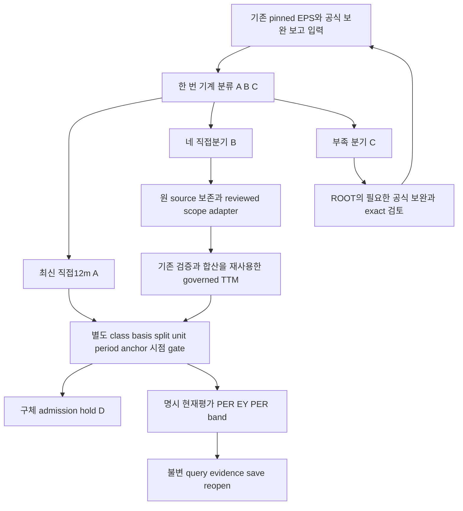

# 공식 보고 분기 EPS·TTM 연결 — 실행 계약·로컬/운영 인수, 2026-11-16

## 목적·승인·현재 범위

공식 보고 Q4 EPS를 보완하고 호환되는 직접 보고4분기를 합한 governed TTM을 가격 입력에
연결해 실제 PER/earnings yield/사용자 PER band를 늘린다. 기존9개 직접 FY 경로와 다른
가치 지표, 원 발행물·저장 이력을 보존한다. MSFT/NVDA 및 이미4분기가 있는 HON/ABBV를
초기 대상 삼되 회사명을 조건으로 계산 엔진을 분기하지 않는다.

사용자는 수집·준비·실제 API/UI·명시 저장/재시작·별도 Sol 독립 검증·운영·PR/필수 CI/main까지
승인했다. **E0 설계와 아래 최소 소스 접점은 ROOT가 수락했고 단일 writer의 구현을 허용했다**.
현재 EPS PR 제품 소스는 `4e4216555b5425250ed74c45cead95c2d6130c90`으로 동결됐다.
별도 Sol의 source/실자료/실제 consumer 및 로컬 runtime 조합 검증은 PASS이며 ROOT는
2026-11-16T09:35:39.342503Z에 **로컬·운영 인수**했다. 기존 timeline을 보존하는 운영 소스는
별도 local-only `5c37c0896169f29083ec8a1825c8e5f4e29e329c`다. PR107은 draft이며 제품4e 전체 CI는
3,279PASS/47SKIP으로 성공했다. 최종 문서 head CI/main은 대기다. ROOT가 공식 수집·회계/범위 승인·실발행·
운영·원격 전달을 맡고, 사용 가능한 GPT-6.1 Sol 단일 writer가 허용된 변경을 작성한다.
독립 Sol은 별도 읽기 전용 역할이다. writer의 network/수집/운영/commit/push는 금지다.

기준은 PR106을 포함한 main `75ac14efb8fcff537cbd5aa744f1b4b1118cd748`, branch
`codex/reported-quarter-eps-ttm`, 전용 worktree `work/reported-quarter-eps-ttm-20261116/source`다.
기존 worktree/runtime/source·Raw·승인·journal·AGENTS/지침/skills는 수정하지 않는다.
소스/자료/소비자 독립 검증과 실제 운영 결과는 아래 후속 기록 및
[109회사 결과표](reported-quarter-eps-company-results-20261116.md)에 구분한다. 이전 목표 PR106은
main 기준에 포함됐고 이번 목표의 main 병합 완료를 뜻하지 않는다. 초기 작성자 검사와 중간
대기 기록은 당시 단계이며 최신 상태는 마지막 운영 인수/원격 전달 표가 우선한다.

## 기존 계약·재사용 기준

[전달 절차](delivery-workflow.md), [architecture](../architecture/overview.md),
[layers](../architecture/layer-model.md), [Analytical 모델](../architecture/analytical-data-model.md),
[기간 규칙](period-rules.md), [공통 EPS 입력](price-common-inputs-20261114.md),
[가격 지표](price-related-metrics-20261116.md),
[기업별 준비](company-valuation-readiness-20261116.md)를 따른다.

- Raw/Analytical 보고 관측과 Derived Metrics 계산은 별개다. EPS에 FY−YTD/누적 차감,
  연간 이월, quarter×4 또는 순이익÷실제 shares 추정을 사용하지 않는다.
- `derive_market_eps_ttm`/`market_eps_diluted_ttm_direct_qtd_v1`은 존재한다. 정확히4개의
  직접 diluted-total QTD, fiscal 좌표 연속성·실제 경계·단위·전체 scope·basis·source cutoff를
  검증하고 signed Decimal 합계를 낸다. 보고 FY EPS와 별도로 유지한다.
- 기존 common109의 basis declarations는 null이어서 그 derived 결과는 적용 승인이 없다.
  회사/티커 또는 같은 값만으로 basis를 승인하지 않는다. basic/continuing/non-GAAP EPS를
  diluted-total로 바꾸지 않는다.
- 기존 price binder는 EPS `DIRECT`만 받고 DIRECT_REPORTED를 출력한다. 실제 소비자는
  `GOVERNED_DIRECT_QTD_TTM`도 받아들이므로 그 사이의 명시적 typed 입력 연결이 필요하다.
  generic SUM을 EPS에 개방해 우회하지 않는다.
- 최종 v2의322관측/100grant,9FY PER 경로, 다른 가치 지표 및 과거 MSFT13grant를 유지한다.
  새 bundle/publication에서 대상 current grant의 빈 EPS 역할만 추가한다. 기존 직접 EPS 역할은 대체하지 않는다. 같은 known-on의
  중복 grant를 append하지 않으며 옛 bundle/발행물·saved source를 고치지 않는다.

## 기계적 cohort와 의미 승인 분리

ROOT는 기존 financial_inputs13,549행과 fresh65 후보4,372개 중 EPS를 한 번 대조했다.
새109 Raw 감사/재수집은 하지 않았다. 보완 전 기계 분류는 A9/B2/C98, 공식 Q4 두 개를
연결한 뒤 후보 분류는 A9/B4/C96이다. B는 수치 승인이나 주식 basis 승인 자체가 아니다.

| 경로 | 의미·초기 대상 | 처리 |
| --- | --- | --- |
| A |최신 anchor의 직접12m 존재9회사 |기존 FY 역할/값/lineage 보존 |
| B |정확히4direct QTD: HON/ABBV, Q4 보완 후 MSFT/NVDA |scope/basis/시점 승인 뒤 governed TTM |
| C |필요 분기/동일 scope 미완성96회사 |기존 Raw/공식 자료의 구체 missing·conflict를 설명; 없는 값을 추정하지 않음 |
| D admission |class/split/currency/scope/readiness 또는 승인 미충족 |A/B/C와 별도 gate/이유. 기존22scope hold 등을 기계 분류에 더하지 않음 |



ROOT가 아래 세 회사의 exact input/basis를 승인했다. cached 어댑터 자체 검사에서 합이
일치했고 새 불변 발행물·실제 API에서도 확인했다. 실제 사적 UI/재시작·별도 consumer 검토·ROOT 운영 인수를 완료했다. PR107은 draft이고 제품 CI는 PASS이며 최종 문서 CI/main은 별도 대기다. 실제 fiscal 경계와 각 원 observation ID는 선언에 바인딩한다.

| 대상 | 네 직접 보고 EPS | 후보 합 | TTM 실제 경계(EXCLUSIVE) |
| --- | --- | ---: | --- |
| MSFT |FY26Q2 5.16, Q3 4.27, Q4 4.81, FY27Q1 4.92 |19.16 |2025-10-01–2026-10-01 |
| NVDA |FY26Q3 1.30, Q4 1.76, FY27Q1 2.39, Q2 2.46 |7.91 |2025-07-28–2026-07-27 |
| HON |FY25Q4 −0.18, FY26Q1 1.29, Q2 17.83, Q3 2.08 |21.02 기계합·사용 금지 |PER_SHARE_BASIS_MISMATCH admission 보류 |
| ABBV |FY25Q4 1.02, FY26Q1 .39, Q2 2.03, 신규Q3 2.37 |5.81 |2025-10-01–2026-10-01 |

HON은 Q1 diluted shares638.4m와 Q2 318.6m 차이를 계기로 원문을 확인했다. Q2/Q3
Note1에 **2026-06-29 발효 one-for-two reverse split** 및 표시 share/per-share의 소급 조정이
명시돼 있다. post-split 두 Raw에는 필요한 FY25Q4/FY26Q1 직접3개월 EPS 재보고가 없다.
따라서 D `PER_SHARE_BASIS_MISMATCH`로 보류하며21.02를 typed EPS로 만들거나 자동 환산하지
않는다. 현재 PER/EY/PER band의 미준비 이유와 연결된 입력 근거에서 필요한 두 기간을
확인할 수 있다. HON의 기존 cap/PBR 등 다른 승인 역할은 보존한다. 이는 B4와 별도 gate다.

ABBV의 옛 window 합3.54를 최신5.81 대신 사용하지 않는다. MSFT/NVDA의 연간 Raw에 없는
Q4를 연간에서 차감하지 않는다. ROOT가 수집한 SEC EX99의 GAAP diluted 행/3m 열을 선택한다.
NVDA 문서명은 `q4fy26pr.htm`으로99문자가 없지만8-K의 exhibit 연결 증거로 판단한다.

## 수락된 작은 책임 분리·인터페이스

1. **공식 reported-quarter adapter**: ROOT의 pinned 추출 proposal과 원 HTML bytes/locator/
   header를 검증하고 보고 관측 proposal을 만든다. source_kind는 OFFICIAL_REPORTED_HTML_TABLE,
   reported_or_derived는 REPORTED다. XBRL 원관측과 HTML 원관측을 불변 별도 입력으로 보존한다.
2. **reviewed-scope TTM adapter**: exact4입력/ROOT basis 선언을 받아 기계 검증·Decimal 합산을
   재사용하고 별도 DERIVED 결과와 typed GOVERNED_DIRECT_QTD_TTM을 만든다. 네 원값/IDs를
   mutate하지 않고 ordered inputs/값/경계/정의·호환성 증거·actual ready timestamp를 보존한다.
3. **새 current-latest materialization 접점**: 원 daily 계산은 유지하고 승인된 TTM의 현재
   PER/EY만 별도로 만들며 PER band는 이 현재 EPS 근거를 쓴다. historical/series/percentile은
   기존 day별 조건으로 계산한다. API/화면은 계산이 아니라 두 종류의 source context를 표시한다.

원 HTML의 QName/namespace/context/fact ID와 raw dimension signature는 null/
NOT_APPLICABLE_NON_XBRL이다. 이를[]의 undimensioned XBRL 사실로 바꾸지 않는다. 기존 v1의
raw-dim exact 검증을 조용히 완화하지 않는다. **별도 versioned reviewed-scope adapter**가
원 physical scope와 정확한 ROOT mapping을 검증하고 기존 four-quarter 핵심 검증/합산을
공유하는 방식이다. default v1 출력/동작은 byte 계약을 보존한다. 별도 normalized view가
필요하면 자체 view ID와 원 observation 참조를 갖고, 원본의 null/차원/값은 그대로 남긴다.

선택된 구현은 원 관측의 별도 복사/ID 변경 대신 private mechanics에 reviewed scope key를
명시 전달한다. 공개 v1 함수는 override를 받지 않아 기존 full-dimension 비교를 유지한다.
HTML과 XBRL의 physical 형식이 달라도 같은 실제 분기에 다른 source identity가 경쟁하면
자동 선택하지 않고 `AMBIGUOUS_DIRECT_QUARTER_REVIEWED_SCOPE`로 거부한다.

## 승인된 날짜 분리 정책과 필수 guard

기존 ready_on guard에 실제11/16을 기록하면11/13 가격일 계산이 차단된다. ROOT는 이 충돌에
대해 `CURRENT_EVALUATION_WITH_LAGGED_QUOTE`의 versioned opt-in 현재평가 경로를 승인했다.

| 시간/범위 | 이 목표의 의미 |
| --- | --- |
| quote_session/as_of |완료 가격 세션11/13, 기존 가격 day grain 유지 |
| public_financial_information_cutoff |11/13. source known-on/실제 기간/latest anchor 검사는 여기에 제한 |
| evaluation_as_of |requested_as_of와 같은11/16. 정확한 ROOT policy pin의 날짜/범위와 일치해야 함 |
| actual captured/prepared/ready-at |실제 aware timestamp16. 공개 filed date와 다르며 null/13으로 backdate하지 않음 |
| daily/historical readiness |각 과거 day 기준 그대로; 새 입력이 그날 ready가 아니면 차단 |

새 현재 PER/EY/PER band에서만 actual ready≤evaluation 시각을 검증한다. 미래 preparation,
같은 날이지만 evaluation 이후인 ready timestamp, 날짜를 수동 증가시킨 config,13후 공시를
거부한다. policy는 quote/batch/대상 입력·승인/준비 시각 범위를 exact pin으로 한정해야 한다.
기존 v1의 basis available_on 검사도 공개 정보 cutoff와 실제 승인/준비 cutoff를 혼동하지 않는
명시적 접점이 필요하다. financial_as_of를 전역16으로 바꿔 통과시키지 않는다.

현재 결과는 as_of13과 evaluation16/readiness_mode를 함께 갖고 historical_ready/
backtest_eligible은 false다. 같은13의 과거 series 행과 다른 판단임을 UI/evidence/save/export에
보인다. current grant를 추가하면서 기존 book/다른 역할의 day별 가용성을 일괄 늦추지 않는다.
default/old config·publication·saved payload/export에는 이 새 빈 metadata를 추가하지 않는다.

## 확정 입력·승인 스키마

| 자료 | 필수 내용 |
| --- | --- |
| reported-quarter proposal |CIK/ticker,8-K accession/form/filed date, exhibit 연결, source URL/document/type, source/capture manifest pins, aware capture/extracted time, row/value XPath·raw text·table header/hash, GAAP/diluted-total/3m/단위, fiscal 좌표·실제 시작/end convention·calendar 증거, 원 XBRL identity/dimensions null |
| exact reported-source receipt |reviewer ROOT/status·proposal pin·승인할 record IDs/hashes, 실제 값/locator/기간·단위·source-format 검토 범위; source bytes 변경 시 거부 |
| TTM scope/basis declaration |정확4 original observation IDs/content pins, CIK/security/class/currency/split basis·GAAP diluted-total scope, 각 원 full scope/원 형식과 승인된 compatibility mapping, latest financial anchor, source public-known 날짜와 실제 approval/ready timestamps, period/calendar/evidence pins |
| exact TTM receipt |위 proposal/declaration pins와4입력·합/정의버전·scope mapping 승인. 현재 CIK/티커나 기존 cap 승인으로 대체하지 않음 |
| current evaluation config/policy |mode/version, ROOT decision 및 exact 대상/config pins, quote_session/price batch, requested/evaluation day·aware evaluation timestamp, public cutoff13·실제 ready 범위 |
| 결과/진단 |A/B/C route와 독립 admission gate, missing quarter/ambiguous/source/scope/time reason, ordered source values·formula·period/definition version·known/ready/evaluation/quote 시점, 원 source refs |

실제 실행은 writer plan `eps-ttm-plan-v1`과 이를 pin한 ROOT exact receipt를 사용한다.
초기 ROOT draft-v1은 역사 자료이며 실행 입력이 아니다. proposal 없이 approved boolean만으로
admission하지 않는다. 동일 공식 Q4의 SEC/IR 중복은 두 입력이 아니라 한 exact observation과
corroborating evidence로 처리하고, 서로 다른 값/범위를 자동 dedup하지 않는다.

## 구현 파일·검사·수락 단계

ROOT가 수락한 소스 범위는 `src/sec_xbrl/metrics/reported_quarter_eps.py` 신설(adapter/diagnostics/typed TTM),
`market_inputs.py`의 default 보존 핵심 검증 재사용 접점, `price_financial_inputs.py`의 별도
governed EPS binder, `examples/screening/prepare_reported_quarter_eps.py` 신설 offline CLI,
기존 `prepare_price_metrics.py`/price publisher의 current-only 접점과 reader/service/evidence,
필요한 price UI 및 관련 focused tests다. 추가로 `company_valuation_readiness.py`의 exact
GOVERNED_DIRECT_QTD_TTM/EPS 전용 승인 분기와 `price_related.py`의 검증된 current-only ready
비교 접점을 수락했다. 다른 역할의 단일 Analysis/source guard는 유지한다.

검사는 source/locator/header·3m vs12m·GAAP/non-GAAP 변조, HTML null identity 보존,4분기
중복/누락/불연속/52·53주·기간/scope/class/unit/split/future known/ready, signed/zero Decimal,
정확 ROOT pin·날짜/시각 mutation 거부, source review의 회사/원4 IDs·class/basis/window 대조와
approved/hold CIK 교집합 거부, source_kind/anchor·typed 연결을 다룬다. 현재 latest와
과거 같은 날짜의 다른 ready 기준, PER/EY/band 동시 연결, old322/100·9FY·다른 지표/정의·
원 저장/export 보존 및 실제 대상 사례를 확인한다. HON의 네 값이 있어도 위 실제 basis
경계가 승인되지 않으면 거부되는 회귀를 필수로 한다. unit test는 network 없이, 실제 자료 검증은
ROOT의 cached pinned inputs로만 한다. 지금 전체109 재조사나 전체 테스트 재실행은 하지 않는다.

| 단계 | 수락 기준 | 현재 |
| --- | --- | --- |
| E0 계약/설계 |책임·schema·시점 정책·허용 파일 ROOT 수락 |ROOT 수락·구현 허용 |
| E1 보고 입력/TTM |exact source/basis 승인·기계 검증·불변 typed/diagnostic 산출물 |ROOT exact 승인·실발행·별도 Sol source/artifact PASS |
| E2 현재 소비 |실제 PER/EY/band·시점 근거·저장/원본 재열기·cold restart,9FY/과거 보존 |실제 API/Chrome/8저장 cold restart 및 별도 consumer/runtime PASS·ROOT 운영 인수 완료 |
| E3 전달 |동결 SHA·별도 Sol PASS·ROOT 로컬/운영·PR/필수 CI/main 실제 결과 분리 |4e source 및5c37 local runtime 독립 PASS·로컬/운영 인수 완료; draft PR107·제품 전체 CI PASS/최종 docs CI/main 대기 |

ROOT 초기 입력: `evidence/official-q4-reported-proposals-v1.json` SHA256
`00874ffd9cbe314fe90adfe39fc211cfd0ff36a9a2c19e2066d15468d58a7c68`, 날짜 정책 결정
`root-current-evaluation-decision-v1.json` SHA256
`3961356aaaca1607be97f0b30a2e462db8367a8103f74b57a0fc3e0bb0cb39c6`, 기계 cohort
`cohort-mechanical-diagnostic-v1.json` SHA256
`e7237cf8f25eb39164f17f504dd4320076ca8fb2c2ccdbb0774c7d366c851978`다.
경로 기준은 새 작업 폴더이며 계획/규범은 이 추적 계약에 둔다. 입력 수집 완료와 source/basis
최종 승인, 구현/운영/main 완료를 합치지 않는다.

## 최초 writer 동결 시점 기록 — 구현 후보의 재현·작성자 검사, 2026-11-16

실행 설정은 `eps-ttm-run-v1`의 `plan`/`approval` 절대경로 SHA256 pins다. plan은
`base_financial_bundle`, `source_review`, `quarter_source_proof`, `evaluation_decision`,
`source_pins`, `companies`, `holds`를 갖는다. 회사별 ordered4 `input_refs`는 kind, source pin,
원 observation ID, canonical JSON `record_sha256`, 실제 기간을 고정한다. source mapping은
`EXACT_REVIEWED_SOURCE_SCOPE_V1`, 원4 IDs, target EPS scope,
`COMPATIBLE_NO_RESCALE`, evidence pins를 고정한다. ROOT receipt는 reviewer ROOT,
status `APPROVED_FOR_EXACT_DIRECT_QTD_TTM`, exact plan pin, approved CIKs, aware approved_at다.

최종 실행 plan SHA는 `cb45e8b2468d35053a31a7112466f65e1c15b9bc01d4ea1f9a230824ec622f83`,
ROOT 승인-v2는 `0d9e23b675ba2be64edcb65630c9aafac1bacf1d1067242ba87542b31f24d3f4`,
run config-v2는 `b0813982e7464fb782ef9f1a73500ce536585fce8cb6ebef1eb8f23753d3a37a`다.
원 관측10XBRL+2HTML 및 HON4XBRL source proof를 재사용하고 원 풀/Raw를 재생성하지 않았다.

```bash
PYTHONPATH=src /path/to/project/.venv/bin/python examples/screening/prepare_reported_quarter_eps.py derive --input /absolute/run-config.json --sha256 RUN_SHA256 --output /new/derivation.json
PYTHONPATH=src /path/to/project/.venv/bin/python examples/screening/prepare_reported_quarter_eps.py verify --input /new/derivation.json --sha256 DERIVATION_SHA256
PYTHONPATH=src /path/to/project/.venv/bin/python examples/screening/prepare_reported_quarter_eps.py augment --input /new/derivation.json --sha256 DERIVATION_SHA256 --output /new/financial-input-bundle.json
```

출력은 create-only다. derive가 실제 aware 준비 시각을 기록하며 verify는 그 시각으로 승인된
계산을 재현한다. augment는 기존322관측을 byte 동일하게 보존하고 새 EPS3개를 더해325관측,
100grant를 유지한다. 세 current grant에만 EPS 역할/derivation evidence를 추가하며 기존
known/ready 날짜를 늦추지 않는다. 이 수치는 `/tmp` cached 자체 검사 결과이며 최종 발행물
인수 결과가 아니다.

현재 평가 policy는 `eps-current-evaluation-policy-v1`이며 `mode`, ROOT `decision` pin,
`evaluation_as_of`, aware `evaluation_at`, `quote_session`,
`public_financial_information_cutoff`, `derivation`, `financial_inputs`, `price_batch` pins를
필수로 한다. ROOT receipt는 `eps-current-evaluation-root-acceptance-v1`, reviewer ROOT,
status `APPROVED_FOR_EXACT_CURRENT_EVALUATION`, exact `policy` pin, aware `approved_at`다.
price publication config의 선택 필드는 `current_eps_evaluation: {policy: PIN, approval: PIN}`다.
해당 필드가 없으면 기존 준비 판정과 출력 계약을 쓴다.

현재 ready opt-in은 producer 경계에서만 exact 정책/원문 재현을 검증한다. Reader/API/저장
재열기는 불변 발행값과 작은 derivation/정책 source pins를 읽으며 원37MB pool이나 HTML을
다시 파싱하거나 EPS를 재계산하지 않는다. 새 결과/근거/저장/export context에 평가16과 종가13,
과거 준비 검증이 아니라는 표시를 보존한다. 기존 발행물에는 빈 새 context를 더하지 않는다.

작성자 focused 검사: 122Python PASS(새26개 및 기존96개),26Node PASS(가격15/공통입력5/Q4연속6),
변경 Python Ruff와 diff 검사 PASS. 새26개 중1개는 명시 cached config/hash 환경변수로 실행한
실제 Root 입력 검사이며 기본 CI에서는 이 cached 검사만 skip한다. 새 검사에는 실제 HON 경계의 명시 HOLD·같은 기준의 필요한 두 직접 기간, null
HTML identity, format 간 같은 분기 경쟁, source/approval/hash/단위/기간/known/aware-ready
변조 거부, 현재와 과거13일의 서로 다른 결과, 기존 FY·자본 보존, custom PER band와 명시
저장/cold reopen, consumer 재계산 금지를 포함한다. 실제 browser/독립 최종검토/운영·PR·CI/main은
ROOT가 source 동결 뒤 별도로 실행한다.

검사 재현은 위 project Python으로 `pytest -q`에
`tests/screening/test_reported_quarter_eps.py`, `test_market_inputs.py`,
`test_price_related_metrics.py`, `test_price_metric_publication.py`,
`test_company_valuation_readiness.py`, `test_company_valuation_fresh_preparation.py`,
`test_company_valuation_bindings.py`를 전달한다(각 파일은 같은 screening 디렉터리).
실제 캐시 검사는 `SEC_XBRL_EPS_TTM_CACHED_CONFIG=/absolute/eps-ttm-run-config-root-v2.json`과
`SEC_XBRL_EPS_TTM_CACHED_SHA256=b0813982e7464fb782ef9f1a73500ce536585fce8cb6ebef1eb8f23753d3a37a`
환경변수를 명시한다. Node 검사는 `node tests/screening/screening_price_metrics.test.cjs`,
`screening_market_inputs.test.cjs`, `screening_revenue_q4_continuity.test.cjs`를 각각 실행했다.

## 중간 시점 기록 — 제품 소스/실자료 독립 PASS·실제 사적 API 확인, 2026-11-16

제품 소스는 `4e4216555b5425250ed74c45cead95c2d6130c90`으로 동결했다. 별도 Sol은
source/artifact에 PASS를 반환했다. 보고서 `reported-quarter-eps-source-artifact-review-4e42165.md`의
SHA256은 `2e9811bc3c3f82bbb1b8678f375c61d136bd61fae5f7fd8d83e4de6be2f74ad6`다.
이 검토는 실제 브라우저를 조작한 검증이나 최종 운영 인수를 대신하지 않는다.

| 범위 | 실제 확인 |
| --- | --- |
| source/default |새 adapter와 최소 접점 검토, 기존 public v1의6경우 encoded bytes 동일 |
| 검사 재사용 |122개 distinct Python(121+explicit cached1),26Node(15+5+6), Ruff·JS syntax·문서 링크·diff PASS |
| 실제 입력 |원10XBRL+2HTML로 MSFT19.16/NVDA7.91/ABBV5.81 재현, HON은21.02 미승인/D 보류 |
| 실발행 |545개 새 파일 hash·source pins, 기존 가격 batch·세션·28정의·109회사 readiness 보존 |
| 실제 사적 API |109×26=2834 latest 관측,1335가용/1499미준비, PER/EY 각12회사/PBR75/BPS60/cap86 |
| 실제 소비 후속 |ROOT 사적 browser·명시 저장/cold restart PASS; consumer 독립 gate·운영 인수 PENDING |
| 원격 전달 |이번 PR·필수 CI `test`·main PENDING |

초기 동결517195b186 후 독립 검토가 반환한 P2 두 건을 좁게 수정했다. 첫째, 과거13일 행의
`INPUT_AFTER_PRICE_AS_OF`를 공개일만 늦었다고 설명하지 않고 **가격 기준일 이후에 공시되었거나
준비된 입력**으로 표시한다. known10/28·ready16인 행의 Node 회귀가 통과했다. 둘째, 고정16일
fixture가 실제 실행 시계에 의존하던 테스트를 고쳤다. synthetic clock/artifact_time은 aware
fixture 시각을 사용하고 cached 검사는 선언의 승인 기록시점으로 test-only replay한다.
외부 시작 시계를17일로 둔26개 회귀도 PASS다. 실제 운영 ready를 backdate하거나 제품
`_now`/정책을 완화하지 않았다. 두 수정은 UI/테스트뿐이며 제품 Python/CLI blob과 실제
자료 계산은517 동결과 같아 실발행물을 재생성하지 않았다.

최종 새 publication은 `screening-price-metrics-d323dab38f8a6bf51ef96a52`이며 manifest SHA256
`86fad784c394f29465df8f07501e0ee5b32e24863a9a6b2bac514d2040bdce2d`다. 경로는
`data/processed/price_metrics/20261116_direct_quarter_eps_ttm_v1/price_metric_manifest.json`이다.
새 derivation SHA `da6c47c02b14a140e3cd127049476d8cabccdc66cbd8e967fce7c260a214b67f`,
bundle SHA `e8c21e9167fe97d4b4e4faab4d45ca70ca8d2e0d04d4344f58e8bb1e8132b846`를 사용한다.
325관측/100grant 중 기존322관측·97grant는 encoded bytes 동일하다. 나머지 세 current grant는
기존 빈 EPS 역할과 새 derivation evidence만 더했으며 다른 역할·known/ready 날짜는 보존한다.

기존109 가격 batch `4b09adc084546a3c0d98399159823f9f3902af890f0ca7be7033f6aef16cc970`를
재사용했다. 새 수집·가격 재조회·전체 Raw 재감사를 하지 않았다. source/approval/ready 변조
음성검사와 이전A/새B 저장 context의 격리는 독립 검토의 `/tmp` 사적 consumer probe를 재사용했다.
이는 최종 실제 browser/운영 증거와 구분한다. Reader/API/저장 재열기에서 TTM producer를
실패하도록 막아도 저장된 값·네 직접 입력의 근거를 읽을 수 있음을 확인했다.

현재 quote와 public cutoff는13일, 실제 준비는 `2026-11-16T08:38:54.808871+00:00`,
평가는 `2026-11-16T08:40:13.854829+00:00`이다. 현재 평가 policy SHA
`c3c0a3fffa27918de94a2210c79377037d1c48f4c805e2e041a3d3fcc489369c`와 ROOT exact 승인
`c33b40968557d37db3f36a2a3f91808d71f47340130b348ce43381a3239e81b3`를 pin했다.
재무 cutoff를 전역16으로 바꾸지 않았다.13일 series의 PER/EY는 새 입력의 ready16으로 차단되고
current evaluation flag가 없다. 과거 분포·유효/기대 개수·준비 판정은 그대로다. augmented current
grant의 출처를 참조하는 일부 source observation ID는 바뀌지만 과거 값/가용성이 바뀐 것은
아니며 옛 불변 발행물/저장은 수정하지 않았다.

새 EPS 경로는 A9 기존 직접12개월, B3 승인 TTM, B후보였으나 D인 HON1, C96이다. 기계적
A9/B4/C96와 독립 D gate를 구분한다.22scope hold는 C96의 부분집합이다. 실제 PER/EY는
12가능/97미준비이며 fixed PER밴드는12회사에 연결된다. 다른 지표는 PBR75/BPS60/cap86,
P/S9/표준FCF7/EV2/EVRevenue1/EV영업proxy0으로 유지됐다. EVproxy의0가용은 승인된 기간·
범위 입력 부족이지 공통 엔진 미구현이 아니다. 회사별 값·PER/PBR/이익수익률·밴드의 보류는
[109회사 결과표](reported-quarter-eps-company-results-20261116.md)에서 확인한다.

### 1차 사적 browser·명시 저장·cold restart — ROOT 확인

ROOT가 실제 네 기업16행을 조회해 MSFT/NVDA/ABBV 각 PER/EY가 가용하고 HON2행은
기준 불일치 보류임을 확인했다. MSFT 사용자11.25배 band는215.5500, 같은 조건의 세 회사는
PASS/HON은 UNAVAILABLE다. 기존5개 사적 복사 저장에 새 UI 저장2개를 더한7개 SQL 행이
재시작 전후 모두 exact였고 oldA/oldB/currentC의 export3개도 exact였다. page/API 오류는0건이다.
이는 ROOT의 실제 사적 browser 확인이며 별도 Sol consumer gate와 운영 전환을 대신하지 않는다.
해당 독립 gate와 실제 운영 receipt는 아직 대기다.

## 2026-11-16 별도 로컬 runtime 통합 — 동시 운영 기능 보존

이 절의 준비/검사/대기 항목은 운영 전환 전 시점 기록이며, 마지막 인수 절에서 완료 상태를 확정한다.
EPS PR 소스와 구분되는 **로컬 운영 구성**의 후속 기록이다. 다른 chat가 이미
`aabadc222e7149ec177a47b92f9de0ad5e99b04e`의 가격 밴드/timeline 화면을 운영 인수했고,
그 소스는 main 미병합·원격 전달 미요청 상태다. 해당 범위를 이번 EPS PR에 포함하지 않는다.
EPS PR의 제품 소스는 계속 `4e4216555b5425250ed74c45cead95c2d6130c90`이다.

기존 운영30276을 예상한 exact command guard가 실제 PID36476/aabad 구성과 달라 stop을
거부했고, 새 start도 occupied guard에서 중단됐다. 두 경우 실제 운영 변경은0이다. ROOT는
현재 인수된36476의 정확한 구성/보호 자료를 새 baseline으로 확인한 뒤 양쪽 기능을 보존하는
별도 local runtime을 준비했다. 과거 PID를 근거로 현재 프로세스를 종료하지 않았다.

로컬 branch `codex/eps-ttm-operating-integration`의 동결 commit은
`5c37c0896169f29083ec8a1825c8e5f4e29e329c`다.4e 위에 기존 aabad의9개 제품/테스트 파일을
3-way 적용하고 충돌을 해소했다. 대상은 CSS/JS·price worker/bridge, 고정 band helper,
price timeline 모듈/service 및 두 관련 테스트뿐이다. 고정 밴드 helper는 기존 timeline 경로와
새 현재 EPS의 평가 context/HON 보류 근거를 함께 보존한다. 새 회계 의미·범위·EPS 환산·
준비 정책을 추가하지 않았고 지침/skills 변경도0이다.

| 검증 범위 | 현재 결과 |
| --- | --- |
| 로컬 runtime 코드 |133Python PASS(기존 EPS122+timeline11),17파일183distinct Node PASS, Ruff·JS syntax·diff PASS |
| 실행 환경 재검증 |Node 전체 첫 실행의3건은 sandbox loopback bind/child 제한; 허용된 임시 테스트 재실행에서 해당2파일18건 모두 PASS |
| 실제 불변 자료 |새 publication86fad와325관측을 재발행/재생성하지 않음; stage-v2 API2834행의 모든 필드가 stage-v1과 동일 |
| 새 TTM 과거 차단 |MSFT/NVDA/ABBV 각754timeline의13일 PER/band는 미준비/null, 실제 ready16 유지 |
| 현재 band |MSFT 사용자11.25배는215.5500, 현재 평가16/종가13 및 backtest false 유지 |
| 기존 timeline |MSFT BPS754points/252창 유효503,13일 배수8.269463062905594659188240820048076·P508.099344526099717625630952084939205 동일 |
| 실제 사적 UI |A/B/C export exact, HON 이유/시점 확인,3×754timeline의 값/status/band/통계가 기존 aabad 운영 baseline과 exact |
| 사적 명시 저장 |새 timeline UI 저장1개로7→8; 기존7SQL exact 보존 |
| 진행 중 |사적 cold restart54360→48684 same-config 후 확인 중; 별도 runtime 독립 gate·운영 전환 대기 |

제품 소스4e와 기존 source/artifact 검증은 재사용하고, runtime 조합의 검증은 별도 gate로
관리한다. 이 로컬 통합을 EPS PR의 변경 범위나 main 병합 완료로 기록하지 않는다. 실제
운영 전환·최종 독립/ROOT 인수 및 PR/필수 CI/main은 후속 receipt 이후에만 갱신한다.

## 최종 로컬·운영 인수와 원격 전달 상태 — 2026-11-16

ROOT 최종 receipt `root-final-operating-acceptance-v1.json` SHA256
`3049cde1f75d969627a500afb8be502eaaeb5cb192d38ae7156b699bb2e51af6`는
`LOCALLY_AND_OPERATING_ACCEPTED`, 인수시각2026-11-16T09:35:39.342503Z다. 위 중간
PENDING 기록을 이 범위에서 완료로 갱신하며 PR/최종 CI/main까지 완료로 넓히지 않는다.

| 단계/역할 | 최종 확인 |
| --- | --- |
| EPS PR 제품 |4e4216555b5425250ed74c45cead95c2d6130c90;122Python/26Node와 두 P2 수정 검증 재사용 |
| source/실자료/실제 consumer 독립 |별도 Sol PASS, 최종 보고서 SHA6b6598752c78ebbe919bbe6078e314fb660d059d50e738e3f463799abcee3db4 |
| local runtime |5c37c0896169f29083ec8a1825c8e5f4e29e329c; aabad timeline9파일 보존; 원격 미전달 |
| runtime 작성자 검사 |133Python/183distinct Node(17파일), Ruff·JS·diff PASS |
| runtime 별도 Sol |133Python/35Node(가격24·공통입력5·Q4연속6),23pins·3×754timeline·8SQL·4exports 검토 PASS |
| 실제 사적 cold restart |same-config54360→48684, 전체8SQL 및 기존7/기존5 exact, A/B/C/D export4 exact |
| 실제 운영 |정확한 기존36476을 종료하고18765/PID38488로 전환; publication86fad/IDd323dab 동일 |
| 실제 HTTP/Chrome |2834행·PER/EY12·PBR75 확인, NVDA PER20.587864… 실제 Chrome PASS |
| 기존 운영 보존 |19078/d1e/native14·18766 old2·9보호 pins·동시17파일 exact, journal integrity ok, 운영 테스트 저장0 |
| 원격 전달 |[PR107](https://github.com/pluswc/sec_xbrl/pull/107) DRAFT; 제품4e CI43840286761 success·Ruff PASS·pytest3279PASS/47SKIP |
| 남은 전달 gate |최종 docs head의 필수 CI `test`·PR 준비완료 전환·main 병합은 ROOT가 별도 실행/확인 |

runtime 별도 Sol 보고서 `independent-runtime-integration-5c37c08.md` SHA256은
`e8ee434ea315c5205b949158246783ff2e2c60394a3b67b62ad4ad79c2de2460`이다. 독립 검토자는
직접 browser를 조작했다고 주장하지 않으며 ROOT가 수행한 실제 Chrome/HTTP의 pinned
증거23개, SQL 및 timeline 화면을 대조했다.183Node는 작성자 실행 수,35Node는 독립 실행
수로 구분한다. 전체109 산술·원 Raw/공식 수집 재검증을 반복한 것이 아니라 승인된 부모
source/artifact 검증과 새 runtime delta·실제 소비자 증거를 결합해 수락했다.

사적 저장8개는 기존5+TTM UI저장2+timeline UI저장1이다. 재시작 전후 모든8개 SQL 행이
exact이고 A/B/C/D export4개도 byte 동일하다. 오래된 harness 출력 `saves:7`은 권위 있는
SQL 검증을 대체하지 않으며 실제8개 보존을 확인했다. 운영 journal에는 테스트 저장을 하지
않았고 price 저장수0·두 journal integrity ok·원 SHA를 유지한다.

운영 live MSFT BPS는754points/252창 유효503/P508.099344526099717625630952084939205 및
paired cursor를 보존했다. 신규3회사의13일 PER/band는 여전히 미준비이므로 현재16일 TTM의
과거 backfill이 없다. 새 pub와325관측은 재발행0이며 PR4e 계산 소스는 그대로다. 가용성의
최종값은1335/1499, PER/EY12·PBR75·BPS60·cap86이며109회사 표와 같다.

운영 재현/복구는 final receipt의 exact command/package pins를 사용한다. source root는
PR4e가 아닌 local runtime5c37, price manifest는86fad, native financial root/19078 및 기존
auxiliary pins/journals는 보존한다. 전환 전에 현재 PID와 전체 command가 인수된 baseline과
같은지 확인하고 occupied/owner guard를 유지한다. 이 인수의 rollback은 stage-v2의
`rollback-original.json`에 보존된 aabad/36476 구성이다. 원격 PR에는 local runtime timeline
범위를 싣지 않는다. 이후 merge/CI 결과는 Git/PR의 실제 기록으로 확인하며 이 문서 동결
시점에 완료로 추정하지 않는다.

### 제품4e 전체 CI 후속 — 2026-11-16T09:36:04Z

ROOT가 PR107의 제품4e 전체 CI run43840286761 성공을 확인했다. Ruff PASS, pytest
3,279passed/47skipped/29warnings(348.78s)다.47skip는 기존46개와 비공개 cached TTM1개이며
해당 실제 cached 검사는 로컬/독립 실자료 검증에서 별도 PASS했다. GitHub CI가 비공개
Raw/작업 폴더를 필요로 하지는 않는다. 증거 `pr107-product-ci-43840286761.log` SHA256은
`25ba3a728b492ca56e78b2bcb920ea02b9adda58f4f88a98b8b1a1bb524fd5a4`다. 최종 문서 head의
필수 CI와 main 병합은 이 제품 CI와 다른 남은 gate이며 아직 완료로 기록하지 않는다.
