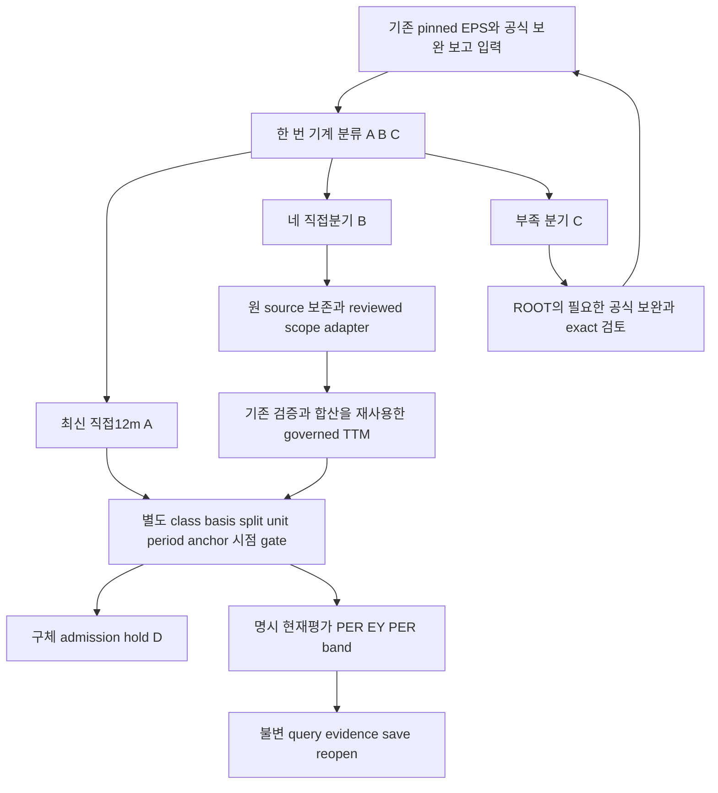

# 공식 보고 분기 EPS·TTM 연결 — 실행 계약·구현 후보, 2026-11-16

## 목적·승인·현재 범위

공식 보고 Q4 EPS를 보완하고 호환되는 직접 보고4분기를 합한 governed TTM을 가격 입력에
연결해 실제 PER/earnings yield/사용자 PER band를 늘린다. 기존9개 직접 FY 경로와 다른
가치 지표, 원 발행물·저장 이력을 보존한다. MSFT/NVDA 및 이미4분기가 있는 HON/ABBV를
초기 대상 삼되 회사명을 조건으로 계산 엔진을 분기하지 않는다.

사용자는 수집·준비·실제 API/UI·명시 저장/재시작·별도 Sol 독립 검증·운영·PR/필수 CI/main까지
승인했다. **E0 설계와 아래 최소 소스 접점은 ROOT가 수락했고 단일 writer의 구현을 허용했다**.
현재는 focused 검사와 cached 자체 검사를 마친 동결 후보 준비 단계다. ROOT가 공식 수집·회계/범위 승인·실발행·
운영·원격 전달을 맡고, 사용 가능한 GPT-6.1 Sol 단일 writer가 허용된 변경을 작성한다.
독립 Sol은 별도 읽기 전용 역할이다. writer의 network/수집/운영/commit/push는 금지다.

기준은 PR106을 포함한 main `75ac14efb8fcff537cbd5aa744f1b4b1118cd748`, branch
`codex/reported-quarter-eps-ttm`, 전용 worktree `work/reported-quarter-eps-ttm-20261116/source`다.
기존 worktree/runtime/source·Raw·승인·journal·AGENTS/지침/skills는 수정하지 않는다.
소스 구현·작성자 검사는 아래에 기록하며, 이 GOAL의 별도 독립 검증·ROOT 로컬/운영 인수·
PR/필수 CI/main은 아직 미수행이다. 이전 목표 PR106은 main 기준에 포함됐다.

## 기존 계약·재사용 기준

[전달 절차](delivery-workflow.md), [architecture](../architecture/overview.md),
[layers](../architecture/layer-model.md), [Analytical 모델](../architecture/analytical-data-model.md),
[기간 규칙](period-rules.md), [공통 EPS 입력](price-common-inputs-20261114.md),
[가격 지표](price-related-metrics-20261116.md),
[기업별 준비](company-valuation-readiness-20261116.md)를 따른다.

- Raw/Analytical 보고 관측과 Derived Metrics 계산은 별개다. EPS에 FY−YTD/누적 차감,
  연간 이월, quarter×4 또는 순이익÷실제 shares 추정을 사용하지 않는다.
- `derive_market_eps_ttm`/`market_eps_diluted_ttm_direct_qtd_v1`은 존재한다. 정확히4개의
  직접 diluted-total QTD, fiscal 좌표 연속성·실제 경계·단위·전체 scope·basis·source cutoff를
  검증하고 signed Decimal 합계를 낸다. 보고 FY EPS와 별도로 유지한다.
- 기존 common109의 basis declarations는 null이어서 그 derived 결과는 적용 승인이 없다.
  회사/티커 또는 같은 값만으로 basis를 승인하지 않는다. basic/continuing/non-GAAP EPS를
  diluted-total로 바꾸지 않는다.
- 기존 price binder는 EPS `DIRECT`만 받고 DIRECT_REPORTED를 출력한다. 실제 소비자는
  `GOVERNED_DIRECT_QTD_TTM`도 받아들이므로 그 사이의 명시적 typed 입력 연결이 필요하다.
  generic SUM을 EPS에 개방해 우회하지 않는다.
- 최종 v2의322관측/100grant,9FY PER 경로, 다른 가치 지표 및 과거 MSFT13grant를 유지한다.
  새 bundle/publication에서 대상 current grant의 빈 EPS 역할만 추가한다. 기존 직접 EPS 역할은 대체하지 않는다. 같은 known-on의
  중복 grant를 append하지 않으며 옛 bundle/발행물·saved source를 고치지 않는다.

## 기계적 cohort와 의미 승인 분리

ROOT는 기존 financial_inputs13,549행과 fresh65 후보4,372개 중 EPS를 한 번 대조했다.
새109 Raw 감사/재수집은 하지 않았다. 보완 전 기계 분류는 A9/B2/C98, 공식 Q4 두 개를
연결한 뒤 후보 분류는 A9/B4/C96이다. B는 수치 승인이나 주식 basis 승인 자체가 아니다.

| 경로 | 의미·초기 대상 | 처리 |
| --- | --- | --- |
| A |최신 anchor의 직접12m 존재9회사 |기존 FY 역할/값/lineage 보존 |
| B |정확히4direct QTD: HON/ABBV, Q4 보완 후 MSFT/NVDA |scope/basis/시점 승인 뒤 governed TTM |
| C |필요 분기/동일 scope 미완성96회사 |기존 Raw/공식 자료의 구체 missing·conflict를 설명; 없는 값을 추정하지 않음 |
| D admission |class/split/currency/scope/readiness 또는 승인 미충족 |A/B/C와 별도 gate/이유. 기존22scope hold 등을 기계 분류에 더하지 않음 |



ROOT가 아래 세 회사의 exact input/basis를 승인했다. cached 어댑터 자체 검사에서 합이
일치했지만 새 실제 발행물/API/UI 인수는 아직 별도 대기다. 실제 fiscal 경계와 각 원 observation ID는 선언에 바인딩한다.

| 대상 | 네 직접 보고 EPS | 후보 합 | TTM 실제 경계(EXCLUSIVE) |
| --- | --- | ---: | --- |
| MSFT |FY26Q2 5.16, Q3 4.27, Q4 4.81, FY27Q1 4.92 |19.16 |2025-10-01–2026-10-01 |
| NVDA |FY26Q3 1.30, Q4 1.76, FY27Q1 2.39, Q2 2.46 |7.91 |2025-07-28–2026-07-27 |
| HON |FY25Q4 −0.18, FY26Q1 1.29, Q2 17.83, Q3 2.08 |21.02 기계합·사용 금지 |PER_SHARE_BASIS_MISMATCH admission 보류 |
| ABBV |FY25Q4 1.02, FY26Q1 .39, Q2 2.03, 신규Q3 2.37 |5.81 |2025-10-01–2026-10-01 |

HON은 Q1 diluted shares638.4m와 Q2 318.6m 차이를 계기로 원문을 확인했다. Q2/Q3
Note1에 **2026-06-29 발효 one-for-two reverse split** 및 표시 share/per-share의 소급 조정이
명시돼 있다. post-split 두 Raw에는 필요한 FY25Q4/FY26Q1 직접3개월 EPS 재보고가 없다.
따라서 D `PER_SHARE_BASIS_MISMATCH`로 보류하며21.02를 typed EPS로 만들거나 자동 환산하지
않는다. 현재 PER/EY/PER band의 미준비 이유와 연결된 입력 근거에서 필요한 두 기간을
확인할 수 있다. HON의 기존 cap/PBR 등 다른 승인 역할은 보존한다. 이는 B4와 별도 gate다.

ABBV의 옛 window 합3.54를 최신5.81 대신 사용하지 않는다. MSFT/NVDA의 연간 Raw에 없는
Q4를 연간에서 차감하지 않는다. ROOT가 수집한 SEC EX99의 GAAP diluted 행/3m 열을 선택한다.
NVDA 문서명은 `q4fy26pr.htm`으로99문자가 없지만8-K의 exhibit 연결 증거로 판단한다.

## 수락된 작은 책임 분리·인터페이스

1. **공식 reported-quarter adapter**: ROOT의 pinned 추출 proposal과 원 HTML bytes/locator/
   header를 검증하고 보고 관측 proposal을 만든다. source_kind는 OFFICIAL_REPORTED_HTML_TABLE,
   reported_or_derived는 REPORTED다. XBRL 원관측과 HTML 원관측을 불변 별도 입력으로 보존한다.
2. **reviewed-scope TTM adapter**: exact4입력/ROOT basis 선언을 받아 기계 검증·Decimal 합산을
   재사용하고 별도 DERIVED 결과와 typed GOVERNED_DIRECT_QTD_TTM을 만든다. 네 원값/IDs를
   mutate하지 않고 ordered inputs/값/경계/정의·호환성 증거·actual ready timestamp를 보존한다.
3. **새 current-latest materialization 접점**: 원 daily 계산은 유지하고 승인된 TTM의 현재
   PER/EY만 별도로 만들며 PER band는 이 현재 EPS 근거를 쓴다. historical/series/percentile은
   기존 day별 조건으로 계산한다. API/화면은 계산이 아니라 두 종류의 source context를 표시한다.

원 HTML의 QName/namespace/context/fact ID와 raw dimension signature는 null/
NOT_APPLICABLE_NON_XBRL이다. 이를[]의 undimensioned XBRL 사실로 바꾸지 않는다. 기존 v1의
raw-dim exact 검증을 조용히 완화하지 않는다. **별도 versioned reviewed-scope adapter**가
원 physical scope와 정확한 ROOT mapping을 검증하고 기존 four-quarter 핵심 검증/합산을
공유하는 방식이다. default v1 출력/동작은 byte 계약을 보존한다. 별도 normalized view가
필요하면 자체 view ID와 원 observation 참조를 갖고, 원본의 null/차원/값은 그대로 남긴다.

선택된 구현은 원 관측의 별도 복사/ID 변경 대신 private mechanics에 reviewed scope key를
명시 전달한다. 공개 v1 함수는 override를 받지 않아 기존 full-dimension 비교를 유지한다.
HTML과 XBRL의 physical 형식이 달라도 같은 실제 분기에 다른 source identity가 경쟁하면
자동 선택하지 않고 `AMBIGUOUS_DIRECT_QUARTER_REVIEWED_SCOPE`로 거부한다.

## 승인된 날짜 분리 정책과 필수 guard

기존 ready_on guard에 실제11/16을 기록하면11/13 가격일 계산이 차단된다. ROOT는 이 충돌에
대해 `CURRENT_EVALUATION_WITH_LAGGED_QUOTE`의 versioned opt-in 현재평가 경로를 승인했다.

| 시간/범위 | 이 목표의 의미 |
| --- | --- |
| quote_session/as_of |완료 가격 세션11/13, 기존 가격 day grain 유지 |
| public_financial_information_cutoff |11/13. source known-on/실제 기간/latest anchor 검사는 여기에 제한 |
| evaluation_as_of |requested_as_of와 같은11/16. 정확한 ROOT policy pin의 날짜/범위와 일치해야 함 |
| actual captured/prepared/ready-at |실제 aware timestamp16. 공개 filed date와 다르며 null/13으로 backdate하지 않음 |
| daily/historical readiness |각 과거 day 기준 그대로; 새 입력이 그날 ready가 아니면 차단 |

새 현재 PER/EY/PER band에서만 actual ready≤evaluation 시각을 검증한다. 미래 preparation,
같은 날이지만 evaluation 이후인 ready timestamp, 날짜를 수동 증가시킨 config,13후 공시를
거부한다. policy는 quote/batch/대상 입력·승인/준비 시각 범위를 exact pin으로 한정해야 한다.
기존 v1의 basis available_on 검사도 공개 정보 cutoff와 실제 승인/준비 cutoff를 혼동하지 않는
명시적 접점이 필요하다. financial_as_of를 전역16으로 바꿔 통과시키지 않는다.

현재 결과는 as_of13과 evaluation16/readiness_mode를 함께 갖고 historical_ready/
backtest_eligible은 false다. 같은13의 과거 series 행과 다른 판단임을 UI/evidence/save/export에
보인다. current grant를 추가하면서 기존 book/다른 역할의 day별 가용성을 일괄 늦추지 않는다.
default/old config·publication·saved payload/export에는 이 새 빈 metadata를 추가하지 않는다.

## 확정 입력·승인 스키마

| 자료 | 필수 내용 |
| --- | --- |
| reported-quarter proposal |CIK/ticker,8-K accession/form/filed date, exhibit 연결, source URL/document/type, source/capture manifest pins, aware capture/extracted time, row/value XPath·raw text·table header/hash, GAAP/diluted-total/3m/단위, fiscal 좌표·실제 시작/end convention·calendar 증거, 원 XBRL identity/dimensions null |
| exact reported-source receipt |reviewer ROOT/status·proposal pin·승인할 record IDs/hashes, 실제 값/locator/기간·단위·source-format 검토 범위; source bytes 변경 시 거부 |
| TTM scope/basis declaration |정확4 original observation IDs/content pins, CIK/security/class/currency/split basis·GAAP diluted-total scope, 각 원 full scope/원 형식과 승인된 compatibility mapping, latest financial anchor, source public-known 날짜와 실제 approval/ready timestamps, period/calendar/evidence pins |
| exact TTM receipt |위 proposal/declaration pins와4입력·합/정의버전·scope mapping 승인. 현재 CIK/티커나 기존 cap 승인으로 대체하지 않음 |
| current evaluation config/policy |mode/version, ROOT decision 및 exact 대상/config pins, quote_session/price batch, requested/evaluation day·aware evaluation timestamp, public cutoff13·실제 ready 범위 |
| 결과/진단 |A/B/C route와 독립 admission gate, missing quarter/ambiguous/source/scope/time reason, ordered source values·formula·period/definition version·known/ready/evaluation/quote 시점, 원 source refs |

실제 실행은 writer plan `eps-ttm-plan-v1`과 이를 pin한 ROOT exact receipt를 사용한다.
초기 ROOT draft-v1은 역사 자료이며 실행 입력이 아니다. proposal 없이 approved boolean만으로
admission하지 않는다. 동일 공식 Q4의 SEC/IR 중복은 두 입력이 아니라 한 exact observation과
corroborating evidence로 처리하고, 서로 다른 값/범위를 자동 dedup하지 않는다.

## 구현 파일·검사·수락 단계

ROOT가 수락한 소스 범위는 `src/sec_xbrl/metrics/reported_quarter_eps.py` 신설(adapter/diagnostics/typed TTM),
`market_inputs.py`의 default 보존 핵심 검증 재사용 접점, `price_financial_inputs.py`의 별도
governed EPS binder, `examples/screening/prepare_reported_quarter_eps.py` 신설 offline CLI,
기존 `prepare_price_metrics.py`/price publisher의 current-only 접점과 reader/service/evidence,
필요한 price UI 및 관련 focused tests다. 추가로 `company_valuation_readiness.py`의 exact
GOVERNED_DIRECT_QTD_TTM/EPS 전용 승인 분기와 `price_related.py`의 검증된 current-only ready
비교 접점을 수락했다. 다른 역할의 단일 Analysis/source guard는 유지한다.

검사는 source/locator/header·3m vs12m·GAAP/non-GAAP 변조, HTML null identity 보존,4분기
중복/누락/불연속/52·53주·기간/scope/class/unit/split/future known/ready, signed/zero Decimal,
정확 ROOT pin·날짜/시각 mutation 거부, source review의 회사/원4 IDs·class/basis/window 대조와
approved/hold CIK 교집합 거부, source_kind/anchor·typed 연결을 다룬다. 현재 latest와
과거 같은 날짜의 다른 ready 기준, PER/EY/band 동시 연결, old322/100·9FY·다른 지표/정의·
원 저장/export 보존 및 실제 대상 사례를 확인한다. HON의 네 값이 있어도 위 실제 basis
경계가 승인되지 않으면 거부되는 회귀를 필수로 한다. unit test는 network 없이, 실제 자료 검증은
ROOT의 cached pinned inputs로만 한다. 지금 전체109 재조사나 전체 테스트 재실행은 하지 않는다.

| 단계 | 수락 기준 | 현재 |
| --- | --- | --- |
| E0 계약/설계 |책임·schema·시점 정책·허용 파일 ROOT 수락 |ROOT 수락·구현 허용 |
| E1 보고 입력/TTM |exact source/basis 승인·기계 검증·불변 typed/diagnostic 산출물 |세 회사 ROOT exact 승인·구현·cached 자체 검사 PASS; 최종 실발행 대기 |
| E2 현재 소비 |실제 PER/EY/band·시점 근거·저장/원본 재열기·cold restart,9FY/과거 보존 |공통 소비 접점 구현·unit 회귀 PASS; 실제 API/UI/운영 인수 미수행 |
| E3 전달 |동결 SHA·별도 Sol PASS·ROOT 로컬/운영·PR/필수 CI/main 실제 결과 분리 |미수행 |

ROOT 초기 입력: `evidence/official-q4-reported-proposals-v1.json` SHA256
`00874ffd9cbe314fe90adfe39fc211cfd0ff36a9a2c19e2066d15468d58a7c68`, 날짜 정책 결정
`root-current-evaluation-decision-v1.json` SHA256
`3961356aaaca1607be97f0b30a2e462db8367a8103f74b57a0fc3e0bb0cb39c6`, 기계 cohort
`cohort-mechanical-diagnostic-v1.json` SHA256
`e7237cf8f25eb39164f17f504dd4320076ca8fb2c2ccdbb0774c7d366c851978`다.
경로 기준은 새 작업 폴더이며 계획/규범은 이 추적 계약에 둔다. 입력 수집 완료와 source/basis
최종 승인, 구현/운영/main 완료를 합치지 않는다.

## 2026-11-16 구현 후보의 재현·작성자 검사

실행 설정은 `eps-ttm-run-v1`의 `plan`/`approval` 절대경로 SHA256 pins다. plan은
`base_financial_bundle`, `source_review`, `quarter_source_proof`, `evaluation_decision`,
`source_pins`, `companies`, `holds`를 갖는다. 회사별 ordered4 `input_refs`는 kind, source pin,
원 observation ID, canonical JSON `record_sha256`, 실제 기간을 고정한다. source mapping은
`EXACT_REVIEWED_SOURCE_SCOPE_V1`, 원4 IDs, target EPS scope,
`COMPATIBLE_NO_RESCALE`, evidence pins를 고정한다. ROOT receipt는 reviewer ROOT,
status `APPROVED_FOR_EXACT_DIRECT_QTD_TTM`, exact plan pin, approved CIKs, aware approved_at다.

최종 실행 plan SHA는 `cb45e8b2468d35053a31a7112466f65e1c15b9bc01d4ea1f9a230824ec622f83`,
ROOT 승인-v2는 `0d9e23b675ba2be64edcb65630c9aafac1bacf1d1067242ba87542b31f24d3f4`,
run config-v2는 `b0813982e7464fb782ef9f1a73500ce536585fce8cb6ebef1eb8f23753d3a37a`다.
원 관측10XBRL+2HTML 및 HON4XBRL source proof를 재사용하고 원 풀/Raw를 재생성하지 않았다.

```bash
PYTHONPATH=src /path/to/project/.venv/bin/python examples/screening/prepare_reported_quarter_eps.py derive --input /absolute/run-config.json --sha256 RUN_SHA256 --output /new/derivation.json
PYTHONPATH=src /path/to/project/.venv/bin/python examples/screening/prepare_reported_quarter_eps.py verify --input /new/derivation.json --sha256 DERIVATION_SHA256
PYTHONPATH=src /path/to/project/.venv/bin/python examples/screening/prepare_reported_quarter_eps.py augment --input /new/derivation.json --sha256 DERIVATION_SHA256 --output /new/financial-input-bundle.json
```

출력은 create-only다. derive가 실제 aware 준비 시각을 기록하며 verify는 그 시각으로 승인된
계산을 재현한다. augment는 기존322관측을 byte 동일하게 보존하고 새 EPS3개를 더해325관측,
100grant를 유지한다. 세 current grant에만 EPS 역할/derivation evidence를 추가하며 기존
known/ready 날짜를 늦추지 않는다. 이 수치는 `/tmp` cached 자체 검사 결과이며 최종 발행물
인수 결과가 아니다.

현재 평가 policy는 `eps-current-evaluation-policy-v1`이며 `mode`, ROOT `decision` pin,
`evaluation_as_of`, aware `evaluation_at`, `quote_session`,
`public_financial_information_cutoff`, `derivation`, `financial_inputs`, `price_batch` pins를
필수로 한다. ROOT receipt는 `eps-current-evaluation-root-acceptance-v1`, reviewer ROOT,
status `APPROVED_FOR_EXACT_CURRENT_EVALUATION`, exact `policy` pin, aware `approved_at`다.
price publication config의 선택 필드는 `current_eps_evaluation: {policy: PIN, approval: PIN}`다.
해당 필드가 없으면 기존 준비 판정과 출력 계약을 쓴다.

현재 ready opt-in은 producer 경계에서만 exact 정책/원문 재현을 검증한다. Reader/API/저장
재열기는 불변 발행값과 작은 derivation/정책 source pins를 읽으며 원37MB pool이나 HTML을
다시 파싱하거나 EPS를 재계산하지 않는다. 새 결과/근거/저장/export context에 평가16과 종가13,
과거 준비 검증이 아니라는 표시를 보존한다. 기존 발행물에는 빈 새 context를 더하지 않는다.

작성자 focused 검사: 122Python PASS(새26개 및 기존96개),26Node PASS(가격15/공통입력5/Q4연속6),
변경 Python Ruff와 diff 검사 PASS. 새26개 중1개는 명시 cached config/hash 환경변수로 실행한
실제 Root 입력 검사이며 기본 CI에서는 이 cached 검사만 skip한다. 새 검사에는 실제 HON 경계의 명시 HOLD·같은 기준의 필요한 두 직접 기간, null
HTML identity, format 간 같은 분기 경쟁, source/approval/hash/단위/기간/known/aware-ready
변조 거부, 현재와 과거13일의 서로 다른 결과, 기존 FY·자본 보존, custom PER band와 명시
저장/cold reopen, consumer 재계산 금지를 포함한다. 실제 browser/독립 최종검토/운영·PR·CI/main은
ROOT가 source 동결 뒤 별도로 실행한다.

검사 재현은 위 project Python으로 `pytest -q`에
`tests/screening/test_reported_quarter_eps.py`, `test_market_inputs.py`,
`test_price_related_metrics.py`, `test_price_metric_publication.py`,
`test_company_valuation_readiness.py`, `test_company_valuation_fresh_preparation.py`,
`test_company_valuation_bindings.py`를 전달한다(각 파일은 같은 screening 디렉터리).
실제 캐시 검사는 `SEC_XBRL_EPS_TTM_CACHED_CONFIG=/absolute/eps-ttm-run-config-root-v2.json`과
`SEC_XBRL_EPS_TTM_CACHED_SHA256=b0813982e7464fb782ef9f1a73500ce536585fce8cb6ebef1eb8f23753d3a37a`
환경변수를 명시한다. Node 검사는 `node tests/screening/screening_price_metrics.test.cjs`,
`screening_market_inputs.test.cjs`, `screening_revenue_q4_continuity.test.cjs`를 각각 실행했다.
